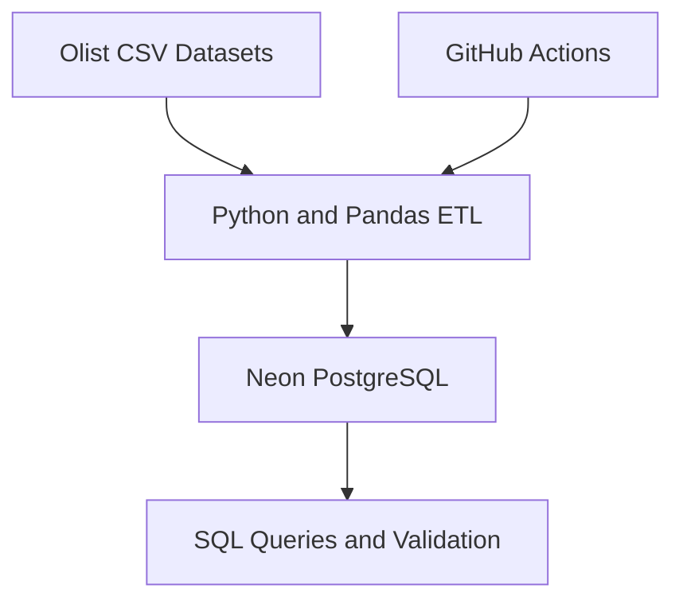

# E-Commerce Data Engineering Pipeline

An end-to-end data engineering project that extracts, transforms, and loads Brazilian e-commerce data into a cloud PostgreSQL database, with automated execution using GitHub Actions.

## Project Overview

This project demonstrates a practical ETL pipeline using the Olist Brazilian e-commerce dataset. Python and Pandas are used to process the data, Neon PostgreSQL stores the resulting tables, and GitHub Actions runs the pipeline automatically.

## Architecture

GitHub Actions runs the ETL script manually or on its configured daily schedule.

## Technologies Used

- **Python** — ETL development
- **Pandas** — Data cleaning and transformation
- **PostgreSQL** — Relational database
- **Neon** — Cloud-hosted PostgreSQL
- **GitHub** — Version control and project hosting
- **GitHub Actions** — Workflow automation

## Dataset

The project uses the public Olist Brazilian e-commerce dataset, containing customer, product, and order information.

Source: https://www.kaggle.com/datasets/olistbr/brazilian-ecommerce

## ETL Workflow

1. Extract customer, product, and order CSV datasets.
2. Transform data using Python and Pandas.
3. Load processed records into PostgreSQL tables.
4. Log processed row counts and database totals.
5. Run the ETL script through GitHub Actions.

## Tables and Results

| Table | Records processed |
|---|---:|
| Customers | 99,441 |
| Products | 32,951 |
| Orders | 99,441 |
| **Total** | **231,833** |

The latest verified GitHub Actions run completed successfully, and the logged database totals matched the processed record counts.

## Automation

The pipeline can be triggered manually through GitHub Actions. A scheduled workflow is also configured to run daily.

## Skills Demonstrated

- ETL pipeline development
- Data extraction and transformation
- SQL and relational database concepts
- Cloud database integration
- Workflow automation with GitHub Actions
- Logging and basic pipeline validation
- Version control with GitHub

## Security

Database credentials are stored in GitHub Actions Secrets and are not committed to the repository.

## Future Improvements

- Add automated data-quality tests.
- Add structured error handling and retry logic.
- Track pipeline execution history.
- Improve incremental loading and duplicate handling.
- Add data visualizations and monitoring.

## Author

Muhammad Shayan

GitHub: https://github.com/mshayan1
## Pipeline Execution Evidence

